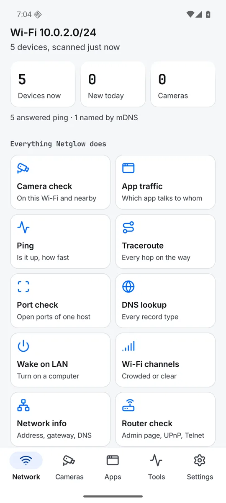

  

<h1 align="center">Netglow</h1>

See who is on your Wi-Fi, give devices names that stay, and run a camera check that tells you what it cannot see.

  <a href="https://play.google.com/store/apps/details?id=com.zanoshky.netglow"><b>Google Play</b></a> ·
  <a href="https://netglow.zanoski.com"><b>netglow.zanoski.com</b></a> ·
  <a href="https://zanoshky.github.io/netglow-app/"><b>User guide</b></a> ·
  <a href="https://github.com/Zanoshky/netglow-app/issues/new/choose"><b>Report a bug</b></a>

  

This repo is the public home for Netglow users: the user guide, bug reports and feature requests. The app itself is an Android app, free with an optional Pro paid once, and its source is not here.

## Quick start

1. Install Netglow from Google Play. It runs on Android 10 or newer.
2. Join your Wi-Fi, open Network and tap Scan.
3. Tap a device to rename it. The name stays, even on a new address.
4. In Settings, Device names file, pick a folder so devices.json survives a reinstall or a new phone.
5. Open Cameras and tap Check again. Read what it cannot see before you trust a clean result.

## The guide

| Page | What is in it |
| --- | --- |
| [Guide](https://zanoshky.github.io/netglow-app/guide.html) | Every screen, in order |
| [Cookbook](https://zanoshky.github.io/netglow-app/cookbook.html) | Short recipes, a few taps each |
| [Runbook](https://zanoshky.github.io/netglow-app/runbook.html) | Symptom, why, and the taps that fix it |
| [FAQ](https://zanoshky.github.io/netglow-app/faq.html) | Answers to common questions |
| [Report a bug](https://zanoshky.github.io/netglow-app/report.html) | What to include in a good report |

The guide source is plain HTML in [docs](docs).

## Report a bug or ask for a feature

1. Search the [open issues](https://github.com/Zanoshky/netglow-app/issues) first. If yours is there, add a thumbs up or a comment.
2. Otherwise open a [bug report](https://github.com/Zanoshky/netglow-app/issues/new?template=bug_report.yml) or a [feature request](https://github.com/Zanoshky/netglow-app/issues/new?template=feature_request.yml).
3. Add your app version, phone model and Android version, and a screenshot if you can. Crop out device names and addresses first: issues are public.

No GitHub account? Write to zanoski.marko@gmail.com.

## License

The guide text and images in this repo are shared under [CC BY 4.0](LICENSE). The Netglow app itself is proprietary and is not covered by this license.
